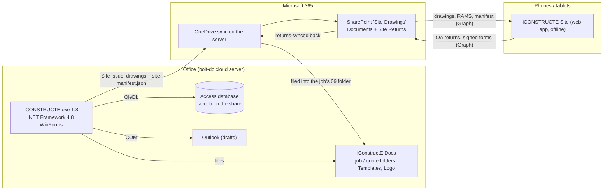
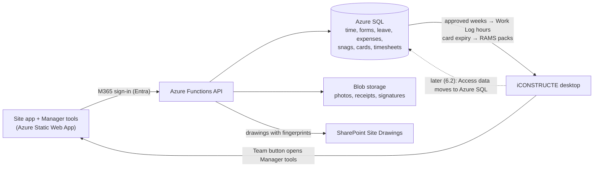

# iCONSTRUCTE: system overview, architecture, features and roadmap

*Bolton Steel Structures Ltd (BSS) · developed for Gripil · status at 19 November 2026 (16:00)*

This is the single summary of what has been built, how it fits together, what is planned, and the reusable Claude
workflows ("skills") built alongside it. **Section 12 is the handover brief for an AI agent continuing the build**:
code map, build and release steps, house rules, and a prioritised backlog with acceptance criteria. The working detail
stays in the living documents listed in section 2: the roadmap, the bug log and the test checklist.

---

## 1. Summary

| | Status (19 Nov 2026) |
|---|---|
| **Desktop iCONSTRUCTE 1.8** (Windows program, Access database) | **In test**: test build 11 on the isolated test bed. Not live; the release is held until Liam is happy with it. |
| **iCONSTRUCTE Site app** (phones / tablets) | **Built, demo mode.** Trial copy published (public GitHub repo `BSSL-mobile-app`, and a private Claude preview link). Needs the Azure / Microsoft 365 set-up to go live. |
| **Manager tools** (holidays, expenses, competency cards, time keeping) | **Built, demo mode** inside the site app. Goes live with Azure. |
| **Roles** (Manager / Supervisor / Operative) | **Built, demo mode.** Waiting for Liam's tick-box schedule of what each role needs. |
| **Health checks** | Health check 1: 14 findings, all closed. Health check 2: logged; batches D–G awaiting go-ahead. |
| **Bugs** | B001–B018 logged; B016 confirmed closed; the rest fixed and awaiting re-test. None open. |
| **Next big pieces** | Delivery notes and Goods Out (required before go-live), Azure set-up, roll-out package, procurement checklist, task bots, planners. |

**Started:** 17 Nov 2026 from the recovered 1.7.5 source. **Source control:** private GitHub repository
`Bolton-Steel-Structures/iconstruct` (141 commits by 19 Nov), plus `Bolton-Steel-Structures/BSSL-mobile-app`
(public trial copy of the site app, demo data only).

---

## 2. Where everything lives

| What | Where |
|---|---|
| Desktop source code | GitHub `Bolton-Steel-Structures/iconstruct` (private), branch `main` |
| Site app source | Same repository, `SiteApp/` folder |
| Site app trial (demo) | GitHub `Bolton-Steel-Structures/BSSL-mobile-app` (public; demo data only); private preview on claude.ai |
| Roadmap (living plan, test checklist, change log) | `docs/ROADMAP.md` in the repository; project doc `claude/ROADMAP.md` |
| Bug log | `docs/BUGLOG.md`; project doc `claude/BUGLOG.md` |
| QMS document review | `docs/QMS-DOCUMENT-REVIEW.md`; project doc `claude/QMS-DOCUMENT-REVIEW.md` |
| Site app API and set-up specs | `SiteApp/API.md`, `SiteApp/SETUP.md`; project docs `claude/site-app/API.md`, `claude/site-app/SETUP.md` |
| Live database | `\\bolt-dc\IconstructE\IconstructE\database` (Access .accdb) |
| Live documents | `\\bolt-dc\IconstructE\IconstructE\database\iConstructE Docs` (Templates, Logo, DocumentStorage) |
| Test bed | Test program and database (isolated copy); test documents in `\\bolt-dc\Network\1 - BSSL\11-Drawing Office\iConstruct Test\Docs` |
| Test builds | `iCONSTRUCTE_1.8.zip` (README, install script, config additions, standard notes) |

---

## 3. Architecture

### 3.1 Today (desktop + site app in demo)



**Desktop iCONSTRUCTE**
- **Program:** Windows Forms, .NET Framework 4.8, x86, C# (about 60,000 lines). The SDK-style project builds on any machine with the .NET SDK.
- **Layers:** `iCONSTRUCTE` (screens), `iCONSTRUCTE.DL` (data access, parameterised OleDb SQL), `iCONSTRUCTE.DTO` (records).
- **Database:** Access (.accdb) on the share. The location comes from `DBLocation` in the config. 1.8 adds **12 tables that create themselves on first use** (`AddedTables`): JobCardHS, JobCardOperatives, SiteIssues, JobCardLocation, JobCardManager, OrderDoor, FabIssues, JobCardExecution, Actions, ActionHistory, ActionOwners, EmployeeLogins. Existing tables are untouched.
- **Documents:** the folder stored in the database's system settings. A test copy overrides it with `DocStorageLocation` in its config (bug B018). Job folders are found by number (`08` finds `08 - Purchase Orders`) through one helper, `JobFolders`.
- **Printing / PDFs:** iCONSTRUCTE's own PDF engine (`SimplePdf` with the shared `DocLayout`). **Crystal Reports has been removed**: no runtime to install, and nothing to re-point at the SQL move.
- **Email:** one Outlook routine (`OutlookMail`) creates drafts with attachments, then releases Outlook. If Outlook is missing, the PDF is shown in Explorer instead.
- **Shared helpers (no double-ups):**
  - `JobFolders`, `JobPdf` (save with revisions), `FileNames`, `OutlookMail`, `CrashLog`;
  - `Theme` (one colour palette), `DocLayout`, `AddedTables`;
  - `Me` (Windows login ↔ employee) and `Actions` (the to-do engine).
- **Errors:** a friendly message, and the details written to `DocStorage\Errors\yyyy_MM.txt`.

**Site app (iCONSTRUCTE Site)**
- **What it is:** a progressive web app, plain JavaScript with no build step. It installs from the browser ("Add to Home Screen"), so there are no app stores.
- **Offline first:** records are kept in IndexedDB and sent when there's signal. Drawings are cached for no-signal sites, and a service worker caches the app itself.
- **Sign-in:** Microsoft 365 (MSAL), with SharePoint / OneDrive accessed through Microsoft Graph. **Demo mode** uses sample data, sample logins and no network.
- **Modules:**
  - `core` (data, sync, roles), `app` (home, jobs, drawings), `time`, `forms`, `qa` / `cert`, `leave`, `expenses`;
  - `cards` (competency cards), `manager` (Manager tools).
- **Libraries:** pdf.js (drawing viewer), jsPDF (completion certificates and form PDFs), MSAL. All are bundled with the app.
- **Roles:** Manager / Supervisor / Operative. What each sees is set in one list in `config.js`, and every screen, tile and form checks it.

### 3.2 Target (Azure, Stage 4)



- **Why Azure:** Access has no per-user or per-table security. Holidays, expenses and check-in locations must only be seen by the person and their manager. Azure SQL behind the API, with Microsoft 365 sign-in, enforces that, and the phones can reach it.
- **Resource names** (from the roadmap):
  - subscription "BSS iCONSTRUCTE", UK South, resource group `rg-bss-iconstructe-uks`;
  - `swa-bss-iconstructe-site`, `func-bss-iconstructe-api`;
  - `sql-bss-iconstructe` / `sqldb-iconstructe`, `stbssiconstructe`;
  - web address `site.boltonstructures.com`.
- **API rules:**
  - operatives only read and write their own records;
  - managers only see and decide for their own team (the Manager field on each employee);
  - photos are served only to the owner or their manager.

### 3.3 Security and data protection notes
- Staff personal data (NI numbers, bank details, medical notes) sits **unprotected** in the Access file today (roadmap 2.1, HC2.18). It should be moved out or locked down; at the latest, it is encrypted or restricted at the SQL move.
- Holiday, expense, card-photo and check-in data is **never** stored in the Access file. It goes in Azure only.
- Location is recorded at check-in and check-out only, never in between. Staff are to be told in writing before go-live (UK GDPR); retention is to be set (e.g. 2 years for time records, 6 years for expenses).
- Site app permissions are to be narrowed to the Site Drawings site only (`Sites.Selected`, HC2.21).

---

## 4. Features built: desktop iCONSTRUCTE 1.8

### Look and speed
- **Modern look ("Office 365" style):**
  - left menu with icons, page headers, orange "Add New";
  - taller list rows, one colour palette, every pop-up restyled;
  - BSS branding, with iCONSTRUCTE orange only around its logo.
- **Faster start-up and screens:**
  - type-to-search on Job Cards and Plant, filtered in memory;
  - look-up boxes find text anywhere in a name;
  - slow work (email reading, folder scans) runs in the background.
- **Stock and Diary tabs removed.**

### Orders, Goods In and purchasing
- **Delivery date compulsory** on steel, connections and bolts lines.
- **Order standard notes by line type, to BS EN 1090-2:**
  - one block each for steel, cold rolled, bolts, galvanising and painting;
  - the material notes use the job's execution class, with full traceability on EXC3 / EXC4;
  - the notes can be edited in `OrderStandardNotes.txt`.
- **Workshop door** (1 / 2 / 3) required for deliveries to the workshop. It appears on the order, the PDF, the email subject and the Goods In calendar.
- **Purchase Order PDF** (own layout):
  - letterhead, supplier box, and deliver-to box with the door banner;
  - items carried over pages, total excl. VAT, notes, page x of y.
  - **Print Order** opens it; **Email Order** saves it in `08 - Purchase Orders`, with revisions ("rev 1, amended"), and opens an Outlook draft.
- **Goods In tab** (was Deliveries):
  - every order red until marked received, then green;
  - overdue and no-date lists;
  - orders before 1 Jan 2025 ignored (`GoodsInFromDate`).
- **Goods In schedule printout** for the shop floor: today + 6 days or a chosen range, overdue first, no prices, "UNCONTROLLED COPY – for information only" with the print time.

### Plant
- **Owned / Hired choice removed.**
- **Rates can be "to be confirmed":** rows show pale yellow until a rate is entered.
- **Email Plant Hire / Print Plant Hire:** iCONSTRUCTE's own Plant Hire Order PDF, filed in 08 with revisions.

### Quotes
- **New quote from a dropped Outlook email:**
  - it finds the customer, contact, project (the email title, with banners removed), town, site and required-by date;
  - it reads the client from a forwarded email, and the town from the title block of an attached PDF drawing or a street name ("1 King Street Salford");
  - it offers "Add as a new customer" or "Add as a contact" from the email signature;
  - on save, the email and its attachments are filed in the quote folder.
- **Quote letter (`Qxxxxx.docx`) and estimate sheet (`Qxxxxx.xlsx`) filled in automatically.** Existing files are never overwritten.

### Job cards
- **Project manager per job:** searchable, and used as the default owner of actions.
- **Execution class per job** (EXC1–EXC4, default EXC2). It's shown on Fab Issues and in order notes, with EXC3 / EXC4 warnings.
- **Site location:** a pasted Google Maps link with an Open map button. The site app gets it for directions.
- **Price table** shows every row. Budget buttons and the RAMS / crane plan ticks share one card.
- **Actions (n)** button: the job's open actions.

### Fab Issue (QFC04, fabrication issue to the workshop)
- **Steelwork and Metalwork sheets** filled from the job card and its orders: suppliers, order numbers, scope, delivery dates and finishes.
- **Drawings:** the 03 assembly drawings are ticked to go with the sheet. Superseded folders (00-SS) are never listed.
- **Checks before issue:** every incoming material row needs its scope, delivery date and order number. Execution class warnings appear for EXC3 / EXC4.
- **Saving and emailing:** the PDF is saved to `03 - Assembley Drawings\Fab Issues` and recorded in a register (with a printable PDF), and an Outlook email goes to the right recipients for the sheet type.
- **Revisions:** New or Amend only. A sent issue is never overwritten, and revisions keep their style (P01 → P02, 1 → 2).
- **Bolts at every Fab Issue (P2):**
  - pick this phase's bolt list from 03;
  - **Send for quote** (BAPP, 2–3 working days, or Whites, small or short notice, suggested from the needed-by date), with an Outlook enquiry and the PM copied;
  - or **Not needed** (with a reason) or **Later**;
  - a Bolts action is recorded per phase, and a Bolts order raised on the job closes it.

### Actions list (P4)
- **One list of everything someone still has to do.** It replaces the H&S tab.
- **Filters:** Mine / On my jobs / Everyone, type, PM, search, overdue, closed. Red is overdue, amber is due within 3 days.
- **Changing an action:**
  - Add, Done, Not needed (with a reason), Re-open, Reassign (with a note) and Print;
  - full history of who did what and when;
  - default owner per action type, else the job's PM;
  - each Windows login is linked to an employee (asked once).
- **Raised and closed automatically:**
  - RAMS and crane plan (from the job card ticks, in step both ways);
  - plant hire rates to confirm;
  - plant off-hire due;
  - bolts per Fab Issue;
  - actions on closed jobs are closed.
- **Ready for later:** the types for transport orders, finisher orders, delivery notes and proof of delivery exist, so these will raise themselves as each feature is built.

### Site Issue (drawings to site)
- **Issuing:** the current drawings (01 / 03) and H&S documents (10) are issued to SharePoint Site Drawings for the job's operatives, with a manifest listing who sees what.
- **Superseding:** an old revision is withdrawn when a new one is issued.
- **Closing:** a closed job's site folder is removed.
- **Safeguards:** only a single job's own folder can ever be deleted, never the library (HC1.2).
- **Site returns** (QA forms, certificates) are filed automatically into the job's own 09 folder. Each one is moved before filing, checked, then removed from OneDrive (HC1.3).

### Printing
- **No Crystal Reports anywhere.**
- Every list's **Print** button prints exactly what is on screen: the filters, sort order and visible columns.
- Rarely used Crystal reports were removed (person, site, budget, delivery note, stock order and single NCR prints).

### Test bed and roll-out safety
- **The test copy keeps its own documents folder** (`DocStorageLocation`). The install sets it automatically, and a start-up check warns if a copy points at another database's documents.
- **The roll-out package** (planned) goes back to the original live folders, with a typed confirmation, a lock check and a rollback folder (roadmap 1.4a).

---

## 5. Features built: iCONSTRUCTE Site app (demo mode)

| Area | What it does | Ref |
|---|---|---|
| **Home** | Check-in card; to-do list (RAMS to sign, cards expiring, approvals for managers); tiles by role | – |
| **Check in / out** | Site picked from the person's jobs; location checked against the site; away-from-site check-ins flagged with a reason; missed check-out entered later; timesheet by week | QFC05 Q05.6 |
| **Drawings** | Only the person's jobs; current revisions only; offline copies; RAMS and crane plan with read-and-sign | QFC05, NSSS 3.1 |
| **Safety forms** | Toolbox talk (each attendee signs), plant pre-use check, lifting accessories check, safe site handover (Principal Contractor signs), near miss / hazard report | QFC05 Q05.4–Q05.10, NSSS 8.2–8.3 |
| **Quality forms** | Day work sheet, foundation check, erection check (line / level / plumb against NSSS tolerances), bolting, site welding, snagging, NCR (QP08) | NSSS 6, 8, 9; QFC05 |
| **QA by job** | Works Inspection (photos per area, time-stamped and geo-tagged), snag list with close-out (photo and signature), completion and handover certificate (PDF) when all snags are closed | NSSS 8.9, QFC05 Q05.11 |
| **Holidays** | Request (half days, bank holidays from GOV.UK), balance against allowance, team calendar; manager approve / decline | 5.3 |
| **Expenses** | Claims with receipt photos, mileage, VAT, job; manager approve / decline / mark paid | 5.4 |
| **My cards** | Photograph each card (CSCS, CPCS / NPORS, IPAF, PASMA, SMSTS / SSSTS, first aid, slinger / signaller, welder qualification BS EN ISO 9606-1 …) with number, category and expiry; shown offline at the gate; reminders when expiring | 5.7, NSSS 5.2 |
| **Manager tools** (managers only) | On site now; waiting for you (holidays, claims, timesheets, cards); today's status per person (flagged check-ins, missed check-outs); who's off in the next 2 weeks; time keeping week grid with **Approve week** (hours to the Work Log against each job); person detail; competency card grid (green / amber / red, "seen the original", CSV export) | Manager dashboard |
| **Roles** | Manager / Supervisor / Operative; operatives get no Manager tools, QA or weekly safety checks; set in `config.js` | – |
| **Sample logins** (demo) | Liam Pilkington (Manager), Ian Jones (Supervisor), Daniel Wiseman (Operative) | – |

---

## 6. How work is run

1. **Ask:** one change at a time, logged in the roadmap change log.
2. **Build:** made, committed and pushed to GitHub. Every change is pushed.
3. **Release when told:** a test build is packaged only when Liam says "build". Each build has release notes and checks (builds 1–11 so far).
4. **Test** on the isolated test bed, never live, using the test checklist.
5. **Sign off:** passed, or a list of failures that go back to step 2.
6. **Go live:**
   1. back up first;
   2. run the roll-out package into the original folders;
   3. one-user check;
   4. tell everyone.
7. **Record** it in the roadmap.
8. **Health check (independent critique)** every 5 changes or before a release. It checks that work is built correctly (NSSS and QFC respected), efficient, and has **no double-ups**.

**Standing rules:**
- Nothing changes the live database structure without a backup.
- Only one version is in test at a time.
- A test copy always has its own documents folder.
- NSSS and the QFC flowcharts are reviewed before responding to a problem.

---

## 7. Quality record

- **Health check 1** (18 Nov), 14 findings, all closed 19 Nov:
  - Fab Issue overwrite;
  - site library delete guard;
  - site returns duplicates;
  - transactions;
  - shared Outlook / PDF / job-folder routines;
  - colour palette;
  - background work and search speed;
  - small fixes.
- **Health check 2** (19 Nov):
  - HC1 fixes confirmed;
  - HC2.1 / HC2.2 closed by the document control rule;
  - still recommended: HC2.3 (make supersede-on-site reliable) and HC2.19 (phone keeps an old drawing under the same name);
  - batches E (filing), F (site app security) and G (SQL readiness) await go-ahead.
- **Bug log B001–B018.** Notable:
  - B018 (High): the test copy was filing into live document folders and reusing live quote numbers. Fixed with a test documents folder, no-overwrite on new quotes and a start-up check.
  - B016 (quote town from a street name) is confirmed closed.

---

## 8. Roadmap (what's next)

### Stage 0–1: make it safe and launch 1.8
- [ ] 0.2 Save the source zips to a Gripil folder; 0.3 nightly backup with a **tested restore** (before go-live).
- [ ] 1.1–1.3 Finish testing 1.8 (test builds), then the final build.
- [ ] **1.4 / 1.4a Go live with the roll-out package:**
  - original live folders, no test settings, templates copied;
  - the 12 tables create themselves;
  - pre-2025 open orders closed at go-live;
  - rollback folder.
- [ ] 1.5 One week of live use, then feedback.

### Stage 2: housekeeping, security and required features
- [ ] **2.1 Staff personal data**: move out or lock down; database password.
- [ ] 2.2 IT: weekly compact / repair, antivirus exclusions.
- [ ] 2.3–2.5 Small speed items (quotes default to 12 months, filter-all gaps, order screen loading twice).
- [ ] **2.6 Delivery notes and Goods Out (required before go-live, QFC04 Q04.9 / Q04.10):**
  - routes built stop by stop (finisher, BSS works, site), one note per leg (2627/012-DN01 …);
  - whole QA lists as the load list (pieces, max length, m², weight, finishes);
  - our van (1,600 kg limit with split / external / carry-on options) or external haulier (transport purchase order and email);
  - the finisher's PO number on the note; signatures and proof of delivery;
  - the Goods Out tab (red until dispatched, Location column).
- [ ] 2.7 / 2.8 Quote letter template tidy; QFC01 Rev C wording.
- [ ] **2.10 ITP that fills itself in** from iCONSTRUCTE records (BSS ITP WM-14-8 received).
- [ ] **2.12 NCRs to match QP08** (disposition, cause, corrective action, effectiveness, trend).
- [ ] 2.13 Approved suppliers brought in from the spreadsheet (later).
- [x] 2.9 Execution class · 2.11 Job folders decided · 2.14 Crystal removed.

### Stage 2B: task bots, procurement and planning
- [ ] **iCONSTRUCTE Bot** (Windows Task Scheduler on the server, e.g. 07:00). Each bot can be switched on or off and has its own recipients:
  - B1 overdue Goods In;
  - B2 plant rates;
  - B3 off-hire;
  - B4 quote follow-up;
  - B5 Fab Issue not sent;
  - B6 Goods Out;
  - B7 RAMS / crane plan;
  - B8 card expiry;
  - B9 Monday digest;
  - **B10 "Your actions" email per PM** each morning.
- [ ] **P1 Procurement checklist per phase** (bolts, paint / galv, transport, cranes / plant), on the Actions list, with failsafes. P2 bolts is done.
- [ ] P3 Phase board (idea only).
- [x] **P4 Actions list** (first version).
- [ ] **P5 Production meeting view** on the live Job Cards list (bigger text, phase / actions / goods in-out / RAMS, expand to phases, add action from the row).
- [ ] **W1 Workshop planner** (6–8 weeks): Steelwork / Metalwork lanes, an unallocated tray from Fab Issues, material markers, a fab-complete tick (the Q04.8 record), and a no-delivery-note flag.
- [ ] **W2 Site labour planner** (12 weeks, replaces the spreadsheet):
  - initials or placeholder numbers, fill right, clash warnings, SUB cells;
  - **WhatsApp instructions**, one editable message per operative.

### Manager dashboard (decided: Azure, in the site app as "Manager tools")
- [x] Built in demo mode (dashboard, approvals, time keeping, cards, roles, sample logins).
- [ ] Liam's tick-box schedule → role permissions.
- [ ] iCONSTRUCTE employee fields **Role** and **Manager** (deputy optional); a **Team** button in iCONSTRUCTE that opens Manager tools.
- [ ] Approved weeks imported as Work Log hours; card expiry available for RAMS packs.

### Stages 3–6: site link, Azure and moving off Access
- [ ] 3.1–3.5 OneDrive sync on the server, the Site Drawings SharePoint site, operative accounts decision (F1 licences / guests / links), then pilot.
- [ ] **4.1–4.5 Azure:** the subscription, hosting the app, decisions (forms, approvers, allowances), the staff notice (GDPR), the database and API. **This is the critical path for the site app and Manager tools.**
- [ ] 5.1–5.7 Site app sections live one at a time (time, RAMS / toolbox, holidays, expenses, quality forms, delivery notes on the driver's app, competency cards), each piloted by Liam, then one gang, then everyone.
- [ ] 6.2 Move the Access database to Azure SQL (estimate 15–25 developer days including a full test pass; Health check 2 batch G gets ready for it now); 6.3 review: keep improving or rebuild as a web system.

### Process review (alongside)
- [ ] QFC01–QFC06 one at a time (QFC04 first): each step, who does it, what record it leaves, where iCONSTRUCTE can do the work, Rev C wording, and the NSSS clause it must satisfy.

### Waiting on Liam
- Tick-box schedule of what each role sees in the site app.
- Health check 2 go-ahead (HC2.3 / HC2.19 recommended, and batches E–G).
- **Site app infrastructure accounts:**
  - Microsoft 365: Site Drawings site, Site Operatives group, app registration;
  - Azure subscription;
  - DNS for `site.boltonstructures.com`;
  - a second admin.
- Path of the live program folder (for the roll-out package).
- Parked information: who does what (default action owners), van and drivers, site hours, NCR paper form, QMS Rev C fixes.

### Wish list
- Fully automatic WhatsApp sending (WhatsApp Business Platform).
- Workshop labour capacity on the planner.
- Webfleet link (site addresses to sat navs, time on site, mileage).

---

## 9. Claude "skills" (reusable workflows) built to date

These are the repeatable ways of working and templates built for BSS. Most live as project documents, so any new chat
can pick them up.

| Skill / workflow | What it does | Where |
|---|---|---|
| **RAMS house layout generator** | Builds a BSS RAMS (Word, A4, Arial) from a content file: cover, method statement sections 1.1–1.19, PPE icon grid, risk matrix and register, BSS footer. Worked example: Neville Hill PCB shed | `claude/rams-template/` (RUNBOOK, build_rams.js, rams_assets.json, example) |
| **Lift plan drawing intake** | Section-by-section question script to produce an A3 lift plan in the 2721-001-LP01 style: coordinates, radii, boom data, ground bearing, lift data table, notes, open items | `claude/liftplan-template/INTAKE.md` |
| **Delivery calendar** (paused) | Weekly calendar of material, connection and bolt deliveries exported from the Access database (Friday task); superseded by the Goods In tab | `claude/delivery-calendar/` |
| **QMS document review** | Review of the QMS documents (QP01–QP08, Welding Quality Manual, ITP, forms) against iCONSTRUCTE and BS EN 1090-2 / NSSS, with gaps and Rev C fixes | `claude/QMS-DOCUMENT-REVIEW.md` |
| **NC1 / DSTV generation** | Triage-first workflow: a colour-coded triage sheet, Liam's review, then NC1 files with set defaults (22 mm holes, 6 mm fillets, ±1 mm) and a self-check that reads the geometry back out | Project memory (conventions) |
| **Fabrication estimating from shop drawings** | Fab and welding hours from Tekla shop drawing PDFs; section procurement lists split open / hollow; £40/hr labour rate (overhead model to confirm) | Project memory |
| **NR 1800 vs NSSS cross-reference** | Clause-by-clause comparison for rail work; NSSS index | Project memory |
| **iCONSTRUCTE development process** | Roadmap, bug log, test builds only on "build", the test bed, health checks, the roll-out package, commit-and-push on every change | `ROADMAP.md`, `BUGLOG.md` |

**Capabilities built inside iCONSTRUCTE that work like skills:**
- **Email-to-quote parser:** reads customer, contact, town, site and dates from an email, its signature and attached drawings.
- **PDF engine:** purchase orders, plant hire orders, Fab Issue sheets and register, the Goods In schedule, list prints.
- **Actions engine:** raises and closes to-dos from evidence in the data.
- **Bolts prompt:** the per-phase failsafe at Fab Issue.

### Skills planned
- **Delivery note and load list builder** (2.6): reads QA lists from 03 and calculates pieces, max length, m², weight and finishes.
- **Self-filling ITP** (2.10) and the **NCR to QP08** workflow (2.12).
- **Task bots** (B1–B10) and the **"Your actions"** morning email.
- **Procurement checklist** (P1) and **planners** (W1 / W2, with WhatsApp instructions).
- **QFC process review** of each flowchart (QFC04 first).
- Optional: turn the RAMS generator, lift plan intake and NC1 triage into saved Claude skills, so they can be started from a slash command in any chat.

---

## 10. Key decisions (for the record)

| Date | Decision |
|---|---|
| 17–18 Nov | Restyle the existing program in place (no rebuild); hold the release until Liam is happy; source in private GitHub |
| 18 Nov | Site drawings via SharePoint plus a phone app; only operatives on the job see it; current revision only |
| 18 Nov | Delivery notes per leg with whole QA lists; van 1,600 kg; spec agreed |
| 18 Nov | Each Fab Issue is one phase; bolts prompted at every Fab Issue (BAPP / Whites) |
| 19 Nov | Job folders kept as today: delivery notes 05, QA 09, H&S 10, Fab Issues in 03\Fab Issues |
| 19 Nov | Document control: only the latest drawings in iCONSTRUCTE; superseded on revision, re-issued to site |
| 19 Nov | Crystal Reports removed; own PDFs; purchase order, plant hire and Goods In schedule are the daily printouts |
| 19 Nov | Test bed is isolated (own documents folder); roll-out is a separate package into the original live folders |
| 19 Nov | Manager dashboard on Azure, inside the site app as "Manager tools"; nothing personal on the shared Actions list |
| 19 Nov | Site app roles: Manager (Liam Pilkington), Supervisor (Ian Jones), Operative (Daniel Wiseman); Liam to supply the tick-box schedule |

---

## 11. Glossary

- **NSSS:** BCSA National Structural Steelwork Specification, 7th edition.
- **QFC01–06:** BSS process flowcharts (enquiry, design, purchasing, fabrication, erection, identification and traceability).
- **EXC2 / EXC3 / EXC4:** execution classes to BS EN 1090-2 (BSS is certified to EXC4; EXC2 is standard).
- **Fab Issue:** the fabrication issue sheet and drawings sent to the workshop; each is one phase.
- **PWA:** progressive web app, a website that installs and works offline like an app.
- **Work Log:** iCONSTRUCTE's labour hours against jobs (feeds job labour cost).

---

## 12. Handover brief for an AI agent continuing the build

Read this whole section before changing anything. Then read `docs/ROADMAP.md` (the full plan, test checklist and change
log), `docs/BUGLOG.md`, and the project's NSSS PDF and QFC01–QFC06 flowcharts. **Owner and sole approver: Liam (BSS).**

### 12.1 First hour checklist
1. Clone `https://github.com/Bolton-Steel-Structures/iconstruct` (private; branch `main`). The repo root is the solution folder.
2. Install the .NET SDK (8 or later). The project is SDK-style and targets .NET Framework 4.8 (x86), so it builds on Linux:
   ```bash
   dotnet build -c Release        # in the repo root; must finish with 0 errors
   ```
   The output is `bin/Release/net48/iCONSTRUCTE.exe` plus dlls. It can't be *run* off Windows; ask Liam to test.
3. Read `docs/ROADMAP.md` sections "How we work" and "Where we are today", then this section's backlog (12.6).
4. Site app: open `SiteApp/index.html` through any static server (`npx serve SiteApp`) with `demo: true` in
   `SiteApp/config.js`. It uses sample logins and data, with no network calls.
5. Check JavaScript after every edit: `node -e "new Function(require('fs').readFileSync('SiteApp/app.js','utf8'))"`
   (repeat for each changed file). A headless browser check (Playwright) is used for screens.

### 12.2 House rules (non-negotiable)
- **Commit and push every change** (`git push origin HEAD:main`). One logical change per commit, plain English message.
- **Never package a test build unless Liam says "build".** Builds are numbered "1.8 test build N" (**last: 11**,
  19/11/2026). See 12.4 for the package.
- **Review NSSS (7th ed.) and the relevant QFC flowchart before answering a problem or designing a feature.** Quote the
  clause or flowchart step in the roadmap entry.
- **Give honest feedback.** Say when an idea is weak, risky or duplicates something already built.
- **Nothing touches live data or live folders from a test build.** The test copy uses its own documents folder
  (`DocStorageLocation` in the config). New files are never overwritten (`DocumentStorage.CopyAndFill`, `JobPdf`
  revisions).
- **No double-ups.** Before writing a helper, search for an existing one (`JobFolders`, `JobPdf`, `FileNames`,
  `OutlookMail`, `DocLayout`, `Theme`, `Me`, `Actions`, `CrashLog`, `AddedTables`). Health checks fail duplicates.
- **Never change existing Access tables.** New data goes in new tables created by `AddedTables.Ensure` (idempotent,
  `CREATE TABLE` if missing). Also keep the SQL Server version in step (HC2.15).
- **Personal data (holidays, expenses, card photos, check-in locations) never goes in the Access file or the Actions
  list.** It belongs in Azure behind the API, where only the person and their manager can see it.
- **Keep the living docs current after each change:**
  1. edit `docs/ROADMAP.md` (tick the item and add a change-log line), or `docs/BUGLOG.md` for bugs;
  2. commit and push;
  3. if working inside the Claude project, also copy the file to the project docs `claude/ROADMAP.md` /
     `claude/BUGLOG.md`.
- **Health check** after every ~5 changes or before a build: an independent review (a fresh agent that hasn't seen the
  work) for correctness against NSSS / QFC, efficiency and double-ups. Log the findings in the roadmap.
- **Plain English everywhere** that Liam reads: release notes, roadmap and on-screen text. UK spelling and dates (dd/MM/yyyy).

### 12.3 Code map

| Area | Files | Notes |
|---|---|---|
| Start-up, config | `iCONSTRUCTE/Program.cs`, `Splash.cs`, `Globals.cs`, `iCONSTRUCTE.DL/SystemSettings.cs` | Config keys: `DBLocation`, `DocStorageLocation` (test bed), `GoodsInFromDate`, `ActionsFromDate`, `BoltQuoteEmails`. Splash warns if documents sit beside another database |
| Data layer | `iCONSTRUCTE.DL/*.cs`, `Database.cs`, `DatabaseHelper.cs`, `Params.cs` | OleDb, parameterised. Many reads still call Access saved queries (export them: HC2.13) |
| Added tables | `iCONSTRUCTE.DL/AddedTables.cs` | 12 tables, created on first use |
| Shell / look | `ModernShell.cs`, `Main.cs`, `Theme.cs`, `ModernDialog.cs`, `Icons/` | Left menu, page headers, palette; `Theme.StyleButtonModern` sizes icon buttons |
| Job cards | `JobCard.cs` plus partials `.Actions`, `.Execution`, `.FabIssue`, `.Location`, `.Manager`, `.Modern` | Partial classes per feature; keep new job card features in new partials |
| Orders / Goods In | `Order.cs`, `Order.Door.cs`, `OrderItem.cs`, `OrderEmail.cs`, `OrderStandardNotes.cs`, `DeliveriesView.cs` | Notes text in `OrderStandardNotes.txt` beside the exe |
| PDFs | `iCONSTRUCTE/Pdf/` (`SimplePdf`, `DocLayout`, `PdfText`, `PurchaseOrderDoc`, `PlantHireOrderDoc`, `GoodsInScheduleDoc`, `ListPrintDoc`) | **All new printouts use `DocLayout`** (letterhead, title band, fields, boxes, tables with repeating headers, page x of y) |
| Fab Issue + bolts | `iCONSTRUCTE/FabIssue/` | `BoltsPrompt.Run` after a successful save |
| Actions | `iCONSTRUCTE.DL/Actions.cs`, `ActionsView.cs`, `ActionForm.cs`, `Me.cs` | `Actions.Sync(user)` raises and closes automatic actions; types in `Actions.Types`; keys like `BOLTS:{job}:{kind}:{issue}` stop duplicates |
| Quotes from email | `iCONSTRUCTE/EmailIntake/`, `Quote.Enquiry.cs`, `QuoteDocs.cs` | Parser has unit-style cases in the change log (B016) |
| Plant | `Plant.cs`, `Plant.Extras.cs`, `PlantEmail.cs` | |
| Site link | `SiteIssueForm.cs`, `SitePublisher.cs`, `SiteReturns.cs`, `iCONSTRUCTE.DL/SiteIssue.cs` | Writes `site-manifest.json` to the OneDrive-synced Site Drawings library |
| Helpers | `JobFolders.cs`, `JobPdf.cs`, `FileNames.cs`, `OutlookMail.cs`, `CrashLog.cs`, `DocumentStorage.cs` | Use these; don't re-implement |
| Site app | `SiteApp/` (`core.js` data / sync / roles, `app.js` shell and routes, `time.js`, `forms.js`, `qa.js`, `cert.js`, `leave.js`, `expenses.js`, `cards.js`, `manager.js`, `sw.js`, `config.js`) | Plain ES2017, no build step. Bump the cache name in `sw.js` on every change (currently `icsite-v11`) |
| Site app back end spec | `SiteApp/API.md`, `SiteApp/SETUP.md` | Endpoints, kinds, role rules; not built yet |
| Tools | `tools/SetTestDocsFolder.ps1` | Used by the test install script |

**Site app data model (`core.js`).**
- **`Data` kinds:** checkins, forms, leave, expenses, snags, inspections, certs, cards, timesheets.
- **`TEAM_KINDS`** are the kinds a manager reads for their team.
- **`Data.decide(kind, id, status)`** records a manager's decision.
- **Roles:** `config.js` `roles` maps a role to features (`drawings`, `rams`, `time`, `leave`, `expenses`, `cards`, `qa`,
  `manager`, `form:<id>`). Every screen calls `IC.can(feature)`, and routes are guarded by `permitted()` in `app.js`.

### 12.4 Test build package (only on "build")
1. `dotnet build -c Release`, then copy into the `release_1.8/` folder:
   - the exe, pdb and dlls;
   - `README_1.8.txt` (CRLF line endings; what's new in this build, how to test, what to look for);
   - `iCONSTRUCTE.exe.config.ADDITIONS.xml`, `OrderStandardNotes.txt`;
   - `Install to test folder.bat`, `SetTestDocsFolder.ps1`.
2. The install bat copies to the test program folder and sets `DocStorageLocation` to
   `\\bolt-dc\Network\1 - BSSL\11-Drawing Office\iConstruct Test\Docs`. It refuses a live `DBLocation`.
3. Zip as `iCONSTRUCTE_1.8_test_build_N.zip`, give it to Liam, and log the build in the roadmap change log.
4. **Live paths (never write to them from test):**
   - database `\\bolt-dc\IconstructE\IconstructE\database`;
   - documents `...\database\iConstructE Docs`;
   - a copy of the live config is in `docs/live/`.

### 12.5 Decisions an agent must respect
- Restyle and extend the existing program; **no rebuild** until Stage 6.3 review.
- Job folder numbers stay as today:
  - 01 GA, 03 assembly drawings (Fab Issues in `03\Fab Issues`), 05 delivery notes, 08 purchase orders, 09 QA, 10 H&S;
  - superseded drawings in `00-SS`.
- Document control: only the latest drawing revision lives in 03; on revision the old goes to 00-SS and the new is re-issued to site.
- Each Fab Issue = one phase. Bolts are prompted at every Fab Issue (BAPP 2–3 working days, Whites for small or short notice).
- Delivery notes: one per leg, numbered `{job}-DN01…`, whole QA lists as the load list; van limit 1,600 kg.
- Actions list is for work items only; owners are office staff; it starts 1 Nov 2026 (`ActionsFromDate`).
- Manager tools live in the site app on Azure; a manager only sees their own team.
- Roles: Liam Pilkington = Manager, Ian Jones = Supervisor, Daniel Wiseman = Operative (Liam will send a tick-box
  schedule of features per role; apply it to `config.js` roles).

### 12.6 Prioritised backlog (do in this order unless Liam says otherwise)

Each item: **what**, **why / reference**, **done when**. Everything is logged in the roadmap; tick it there when done.

**A. Finish 1.8 for go-live**
1. **Fix test feedback from build 11** (as Liam reports it). Log each issue in BUGLOG first.
2. **HC2.3 Reliable supersede on site.**
   - *What:* issuing to site should be all-or-nothing: copy files first, then update the manifest and the database. Roll back on failure.
   - *Why:* NSSS 3.1, latest information used and superseded withdrawn.
   - *Done when:* an interrupted issue leaves the old consistent state, and a re-run completes it.
3. **HC2.19 / HC2.20 Phone drawing freshness.**
   - *What:* key offline copies on a content fingerprint (hash in the manifest), not the file name. Show "last checked X ago", red after 12 hours.
   - *Done when:* a same-name re-issue always replaces the phone copy.
4. **2.6 Delivery notes and Goods Out (required before go-live; QFC04 Q04.9 / Q04.10; NSSS 7):**
   - *What:* a route builder per phase (stops: finisher, BSS works, site). One note per leg, `DocLayout` PDF saved in 05 with revisions.
   - *Load list:* the QA lists from 09 / 03 (pieces, max length, m², weight, finishes).
   - *Vehicle:* van (1,600 kg check, with split / external / carry-on choices) or external haulier (transport purchase order through the existing order code, plus an email).
   - *On the note:* the finisher's PO number; signature boxes; proof of delivery.
   - *Goods Out tab:* modelled on `DeliveriesView`, red until dispatched, with a Location column.
   - *Actions:* raise and close "Delivery note" and "Proof of delivery" (the types already exist).
   - *Done when:* Liam can produce the notes for a three-leg job and the actions close themselves.
5. **1.4a Roll-out package.**
   - *What:* a script that installs into the original live program folder with no test settings, after a typed confirmation, a lock check (nobody in the database) and a backup / rollback folder. It copies templates and lists the 12 tables it will create. Pre-2025 open orders are closed at go-live.
   - *Needs:* the live program folder path from Liam.
6. **Batch E small fixes (HC2.4–HC2.11, HC2.24)** and **Batch G (HC2.12, 13, 15, 17)**. These are cheap and make the SQL move easier.

**B. Data protection**

7. **2.1 / HC2.18 Staff personal data.**
   - *What:* move NI numbers, bank details and date of birth out of the shared Access file, or encrypt them, and add a database password.
   - *Done when:* those fields can't be read by opening the .accdb.

**C. Office productivity (after go-live)**

8. **B1–B10 Task bots.**
   - *What:* a console mode of the exe (`iCONSTRUCTE.exe /bot`), run by Task Scheduler at 07:00.
   - *Settings:* a table holding each bot's on / off switch and recipients.
   - *Sending:* through Outlook or SMTP (decide with Liam).
   - *Start with:* B10 "Your actions" per PM and B1 overdue Goods In.
9. **P1 Procurement checklist per phase.**
   - *What:* for each Fab Issue phase, actions for paint / galv, transport and cranes / plant, raised and closed from orders (the bolts pattern in `Actions.Sync`).
10. **P5 Production meeting view** on the Job Cards list.
11. **2.10 ITP that fills itself in** (template WM-14-8) and **2.12 NCRs to QP08**.
12. **W1 Workshop planner** and **W2 Site labour planner** (WhatsApp message per operative).

**D. Site app and Manager tools go live (needs Liam's Azure / M365 accounts)**

13. **Apply Liam's role schedule** to `config.js`, and refresh the preview and the trial repo `BSSL-mobile-app`.
14. **Employee Role and Manager fields in iCONSTRUCTE**, plus a **Team** button that opens Manager tools.
15. **Stage 4 Azure.**
    - *What:* build the Functions API exactly as `SiteApp/API.md` specifies, with server-side filtering (operatives see their own records; managers see their team), plus Azure SQL and Blob.
    - *Front end:* swap the site app's `Data` layer from demo to the API (the interface is already shaped for it).
    - *Also:* `Sites.Selected` permissions (HC2.21).
16. **Approved weeks → Work Log import**, and **card expiry → RAMS packs**.
17. **Stage 5 pilots** one section at a time.

**E. Later**

18. **6.2 Access → Azure SQL** (15–25 days), then the **6.3 review**: keep improving, or rebuild as a web system.

### 12.7 Open questions waiting on Liam (don't guess these; ask)
- **Roles:** tick-box schedule per role; who manages whom.
- **Go-live:** the live program folder path; the go-live date; default action owners per type.
- **Delivery notes:** van and drivers; site working hours; whether a haulier order uses the normal PO numbers.
- **Azure / M365:** subscription, app registration, Site Drawings site, DNS, a second admin.
- **Bots:** sending method (Outlook on the server or SMTP); recipients.
- **Health check 2:** go-ahead on batches D–G.
- **Clean-up:** confirm that the live Q10678.xls was checked or restored and that the test files were removed from the live folders (B018).

### 12.8 Definition of done (every change)
- [ ] Builds with 0 errors (and JS syntax checks pass for site app files).
- [ ] Follows NSSS / QFC; the reference is noted in the roadmap entry.
- [ ] Reuses the existing helpers; no new duplicates.
- [ ] Test-bed safe (no writes to live paths; no overwrites).
- [ ] Roadmap / bug log updated, committed and pushed.
- [ ] Anything Liam must test is listed for the next build's README.
